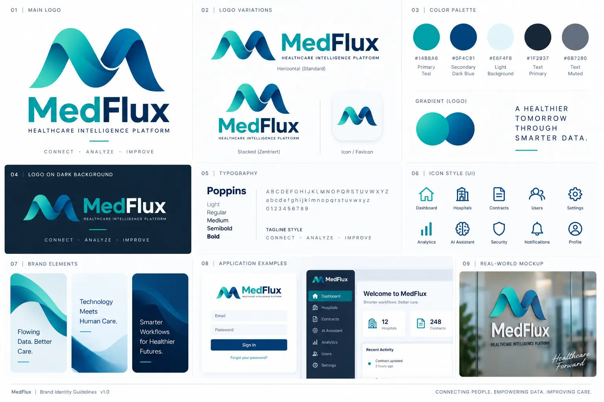

# MedFlux Visual Identity

**Status:** Approved development reference  
**Applies to:** Product UI, product documentation, presentations, diagrams, and future brand assets  
**Source of truth:** This document governs visual decisions for MedFlux. Existing implementations should converge toward it. New frontend work must follow it from the start.



The board above is the approved visual identity reference (version 1.0). The written rules below make its decisions implementable and accessible in the product.

> **Exception 2026-10-11 (product owner): identity colours in the contract header.** The four main facts in the contract header each carry their own colour so they can be told apart at a glance: contract type (teal), contract partner (navy), responsible department (indigo), cost centre (plum). These are identifiers, not signals: each chip always has its own icon and its word (screen readers hear „Vertragstyp: …“ etc.), and none of the colours is used for a signal level. Tokens `--color-tag-{type,partner,department,cost}[-bg|-border]` (light and dark) in `frontend/app/styles/tokens.css`, chips `.tag-chip--*`. Every item in the header (number, chips, facts, term bar) is clickable and leads to where the value comes from or is maintained.
>
> **Exception 2026-10-11 (product owner): AI status in the sidebar is a traffic light.** The sidebar footer (`components/shell/AppSidebar.tsx`) shows only the signal and the word „KI“ (the full status is the tooltip and screen-reader text; for admins „KI“ links to Einstellungen → Lokale KI, where the explanation lives). It shows *done* (green circle with check) when the local AI and its model are ready, *warning* (orange triangle) when the AI or model is not ready or its status cannot be read, and *critical* (red octagon) when the server is unreachable; grey only while the first check runs. This is the one place where green means „system works“ rather than a confirmed result; colour is still paired with shape and word.
>
> **Current decision 2026-10-10 (product owner): „Ruhe & Signal“ (v3), refines „Mein Tag v2“.** The normal state is neutral grey; colour appears only when something needs attention, and never alone: every signal is **colour + shape + word**. Six levels, each with its own silhouette for colour-vision deficiencies: *critical* (octagon with „!“, red), *warning* (triangle with „!“, amber), *info* (circle with „i“, blue), *done* (circle with check, green – **only for a confirmed result**, never for „nothing to do“), *ai* (four-point spark, violet), *neutral* (circle with dash, grey). Primitive: `components/ui/Signal.tsx`; `Badge`, `StatusBadge`, `InlineAlert` and `Toast` use the same shapes. KPI tiles are always neutral (grey icon before the label, value in text colour); attention is shown with `KpiTile signal`. „Nothing to do“ is `EmptyState variant="calm"` (grey line, no green). Token values (light/dark, all signal texts ≥ 5.6:1 on their background, `--color-border-strong` ≥ 3.5:1) live in `frontend/app/styles/tokens.css`; new tokens `--color-icon`, `--color-ai-border`, `--color-neutral-border`. Basis: ISA-101 „gray is good“, pre-attentive processing (Healey), dual coding of icons (Nielsen Norman Group), Okabe & Ito colour-safe palette, positive polarity for reading (Piepenbrock et al., *Human Factors*), ASR A6 Bildschirmarbeit. Reference mock: `Claude outputs/Mein-Tag-Entwurf-v3.html` (static, not part of the app).
>
> *Decision 2026-10-09 (superseded by the line above for KPI tones, empty states and signal colours): „Mein Tag v2“, refines „Sachlich-institutionell“.* Same calm character, but a clear order of importance and colour only where it carries meaning: the page ground is one step darker (`--color-bg: #edf1f5`, secondary text stays ≥ 5.6:1) with a slightly stronger card border (`--color-border: #cfd9e2`); cards, panels and KPI tiles carry a very light shadow again (`--shadow-sm`; dark: `0 1px 2px rgb(0 0 0 / 0.4)`); the sidebar uses `--color-sidebar` (lighter than the ground); content width is capped at 1440px. KPI tiles are coloured by state (`KpiTile tone`: warning/danger colour the value, info/success only the icon square) and are links as a whole. On „Mein Tag“ the header sits directly on the ground without a card, „Handlungsbedarf im Portfolio“ comes first and stands out (count badge, whole rows as links with tinted count pills: AI review violet, missing computable contract end red, other gaps amber), and empty states are compact (`EmptyState variant="compact"`). Links inside cards and lists are not underlined until hover/focus; links in running text stay underlined. Reference: `Claude outputs/Mein-Tag-Entwurf-v2.html` (static mock, not part of the app).
>
> *Decision 2026-10-06, evening (superseded by the line above for ground, border, card shadow and sidebar): direction „Sachlich-institutionell“.* Calmer and flatter for the working environment of a public hospital: the page ground is the flat cool light grey `--color-bg` with **no light spots and no gradients** (`--glow-teal`/`--glow-navy` are transparent); cards and panels are flat (1px `--color-border`, `--shadow-sm: none`; only menus, popovers, dialogs and drawers carry a shadow); the highlighted page header is a plain white `--color-surface` panel with a hairline border, `--radius-md`, a navy eyebrow (`--color-highlight-eyebrow`) and a 24px title; navy `#0f4c81` is the only action colour; **teal appears only in the logo**; control borders `--color-border-strong` are `#7d8c9b` (light, 3.4:1) and `#64768a` (dark, 3.6:1), meeting the 3:1 floor. The sign-in page uses the same flat ground with one surface card. Source: design-system package „MedFlux-Sachlich“.
>
> *Earlier the same day (superseded by the line above for background, header and teal):* **The colour world of the login page applies to all pages.** Primary actions, links and the active navigation use **institutional navy `#0f4c81`** (hover `#0b3d68`) – as in version 1.0. Backgrounds are the cool light blue-grey of the login page (`#f4f7f9`, `#eaf0f4`, `#f8fafc`) with the same soft light spots: teal top left, navy bottom right (`--glow-teal`, `--glow-navy`). Teal remains the brand companion (logo, light spots, highlighted page header). Kept from the earlier update the same day: serif page titles (*Source Serif 4*), flat cards, light highlighted header.
>
> *Earlier the same day (superseded for colours):* After comparing ten leading contract-management products, the product UI uses **one brand colour**. Primary actions, links and the active navigation use **brand teal `#0b7368`** (hover `#095c54`; 5.7:1 and 7.9:1 on white) instead of institutional blue. Blue (`#1d64c2`, `#17509c`) remains for **information** states and the **focus ring**, so it keeps one clear meaning. The bright teal `#14b8a6` is used only for areas and the logo, never as text (2.5:1). Light surfaces use a warm "paper" tone (`#f6f6f2`); page titles use the self-hosted serif *Source Serif 4* (`--font-display`), all other text stays Inter. The highlighted page header is light (teal-tinted) instead of dark navy. Implementation: `frontend/app/styles/tokens.css`. Sections 3 and 4 below describe version 1.0; where they differ, this update applies to the product UI. The logo and its teal-to-navy gradient are unchanged.

---

## 1. Brand foundation

### Product name

The approved product name is **MedFlux**.

- Use the exact capitalization `MedFlux`.
- Do not use `Medflux`, `MEDFLUX`, or `Med Flux` as the primary wordmark.
- Do not append **AI** to the primary product name. AI is a platform capability, not the complete product identity.
- Use the optional descriptor **Healthcare Intelligence Platform** when context requires an explanation.
- Retire **Streamlined Flux** from product-facing use.

### Brand promise

MedFlux turns complex healthcare contract and service data into clear, traceable, actionable work.

### Personality

The visual language must feel:

- Trustworthy and clinically responsible
- Clear before decorative
- Calm under information density
- Modern without appearing experimental
- Precise, auditable, and enterprise-ready
- Human and supportive, never playful or promotional inside operational workflows

### Product principles

Every product view should help the user answer:

1. What happened?
2. Why does it matter?
3. Where is the evidence?
4. What has been confirmed?
5. What must happen next?

Never use invented business data to make a screen appear complete. Render real backend data or a truthful loading, empty, error, or unavailable state.

---

## 2. Logo system

### Approved direction: Professional Healthcare

The logo retains the flowing **M** concept as a symbol of medical workflows, connected systems, and continuous information flow. The mark must be simplified into a clean, balanced form suitable for enterprise healthcare software.

### Canonical product logo

Only **01 — Main Logo** from the approved identity board is authorized for the current product.

- Use the clean production logo containing only the flowing M and the `MedFlux` wordmark.
- Use the same asset in the sidebar, login, organization selection, and branded product surfaces.
- Do not substitute the horizontal, stacked variation, icon-only, dark-background, mockup, or reconstructed code-drawn versions.
- Scaling is allowed only with the original aspect ratio preserved.
- Do not place a descriptor, divider, tagline, or slogan underneath the production logo.
- The favicon is derived from the same clean logo artwork because browser icons require a square container.
- Source asset: `frontend/public/brand/medflux-main-logo.png`.

### Wordmark

- Text: **MedFlux**
- Preferred weight: 650–700
- `Med`: Healthcare Teal
- `Flux`: Institutional Navy
- Keep the wordmark on one line.
- The optional descriptor sits below or beside the wordmark and must never compete with it.

### Symbol

The symbol should:

- Read as the letter **M** at small sizes
- Use two or three controlled flowing paths at most
- Preserve open negative space
- Avoid thin decorative lines that disappear below 24 px
- Avoid 3D extrusion, glass effects, glow, heavy shadows, or photographic texture
- Remain recognizable in one color

### Concept artwork status

The original **MedFlux AI / Streamlined Flux** artwork is a concept source only. It establishes the flowing-M idea and teal-to-navy direction, but it is not a production-ready logo asset. Its extra internal strokes, `AI` suffix, and legacy tagline must not be copied into new UI.

### Clear space

Use the height of the wordmark capital **M** as the minimum clear space around the complete logo. No text, border, icon, or container edge may enter this area.

### Minimum size

- Horizontal digital logo: minimum width 120 px
- Symbol-only digital logo: minimum 20 × 20 px
- Preferred navigation symbol: 28–32 px
- Favicon: use a purpose-built simplified symbol, never a reduced full wordmark

### Logo misuse

Do not:

- Stretch, rotate, skew, or outline the logo
- Recolor it outside the approved palette
- Place it on low-contrast or visually noisy backgrounds
- Add shadows, bevels, gradients outside the approved brand gradient, or animation
- Rebuild the symbol from an unrelated icon
- Use `MedFlux AI` as the primary wordmark

---

## 3. Color system

Color has a functional hierarchy. (Product UI since 2026-10-06: brand teal drives primary actions and blue means information – see the update at the top.) In version 1.0, institutional blue drives primary actions, teal supports the brand and healthy system states, and amber/red are reserved for warnings and critical events.

### Core brand colors

| Role | Token | Hex | Usage |
|---|---|---:|---|
| Secondary Dark Blue | `--brand-navy` | `#0F4C81` | Wordmark, high-emphasis brand text, dark identity applications |
| Primary Teal | `--brand-teal` | `#14B8A6` | `Med` wordmark, logo flow, restrained brand accents |
| Product Blue | `--interactive` / `--accent` | `#0F4C81` | Primary buttons, links, selected controls |
| Product Blue Hover | `--interactive-hover` / `--accent-strong` | `#0B3D68` | Hover and pressed emphasis |
| Focus Blue | `--focus-color` / `--focus-ring` | `#1A66C9` | Accessible keyboard focus |
| Light Brand Background | `--accent-soft` | `#E6F4F8` | Selected or highlighted low-emphasis surfaces |

### Neutral colors

| Role | Hex | Usage |
|---|---:|---|
| Canvas | `#FFFFFF` | Main application background |
| Raised Surface | `#FFFFFF` | Cards, dialogs, menus |
| Subtle Surface | `#F8FAFC` | Section separation, hover backgrounds |
| Muted Surface | `#E6F4F8` | Secondary panels and disabled contexts |
| Default Border | `#DFE7EF` | Standard dividers and card borders |
| Strong Border | `#CBD8E4` | Inputs and emphasized boundaries |
| Primary Text | `#1F2937` | Headings and primary body content |
| Strong Text | `#172033` | Maximum-emphasis product text |
| Secondary Text | `#6B7280` | Metadata and supporting content |

### Semantic colors

| State | Foreground | Background | Meaning |
|---|---:|---:|---|
| Information | `#2F6FD6` | `#E7F0FC` | Informational state |
| Success | `#12896B` | `#E3F6F0` | Confirmed, healthy, completed |
| Warning / Review | `#C2761B` | `#FDF1DC` | Attention or human review required |
| Critical | `#C9403A` | `#FCE7E5` | Failure, deadline risk, destructive consequence |
| Neutral / Unknown | `#55677A` | `#EEF2F7` | Neutral, stale, or unavailable information |

### Brand gradient

Use gradients only in identity-led areas such as the logo, sign-in hero, or a restrained dashboard welcome panel.

Preferred direction:

```css
background: linear-gradient(135deg, #14b8a6 0%, #0f4c81 100%);
```

Do not use the brand gradient for operational buttons, status badges, tables, or large application backgrounds.

### Color rules

- Color must never be the only indicator of status; pair it with a text label and, where useful, an icon.
- Teal must not replace primary blue indiscriminately. *(Superseded for the product UI on 2026-10-06: teal `#0b7368` is the single action colour; blue is reserved for information and focus.)*
- Green indicates success or healthy state, not generic emphasis.
- Red is reserved for critical, error, or destructive contexts.
- Maintain WCAG 2.1 AA contrast for all text and essential controls.

---

## 4. Typography

### Primary brand and UI font

The approved typeface is **Poppins** in Light, Regular, Medium, Semibold, and Bold. Product UI should normally use Regular through Semibold; Bold is reserved for high-emphasis headings and key figures.

```css
font-family: "Poppins", Inter, -apple-system, BlinkMacSystemFont, "Segoe UI",
  Roboto, "Helvetica Neue", Arial, sans-serif;
```

Poppins must be self-hosted inside the repository before it becomes a required runtime dependency. Until local font files are added, the existing local/system stack remains the safe fallback. Never load fonts from an external CDN in the local-first product.

### Type scale

| Level | Size | Weight | Typical use |
|---|---:|---:|---|
| Display | 28 px | 700 | Rare landing or welcome heading |
| Page title | 24 px | 700 | Primary page heading |
| Section title | 20 px | 650–700 | Major content section |
| Card title | 17 px | 600 | Card or panel heading |
| Body | 15 px | 400 | Default readable product text |
| UI label | 14 px | 500–600 | Buttons, inputs, table content |
| Supporting | 13 px | 400–600 | Metadata and hints |
| Caption | 12 px | 500–700 | Badges and compact annotations |

### Typography rules

- Prefer sentence case for headings, buttons, labels, and navigation.
- Keep body line height near 1.45–1.5.
- Avoid font sizes below 12 px.
- Do not use uppercase for full labels or long headings.
- Use weight, spacing, and hierarchy before introducing additional color.
- Numbers in cost, date, deadline, and identifier columns should align consistently.

---

## 5. Layout and spacing

Use a 4 px base spacing system.

| Token | Value |
|---|---:|
| `--space-1` | 4 px |
| `--space-2` | 8 px |
| `--space-3` | 12 px |
| `--space-4` | 16 px |
| `--space-5` | 20 px |
| `--space-6` | 24 px |
| `--space-8` | 32 px |
| `--space-10` | 40 px |
| `--space-12` | 48 px |

### Layout rules

- Use whitespace to group related information before adding borders.
- Keep operational pages information-dense but scannable.
- Use a clear page header, optional supporting text, and a consistent action area.
- Preserve stable placement for page-level primary actions.
- Prefer responsive grids that collapse cleanly instead of horizontal overflow.
- On complex contract screens, maintain independent scroll regions only when their boundaries and purpose remain obvious.
- Never hide essential evidence or audit information behind decorative interactions.

---

## 6. Shape and elevation

| Element | Radius | Elevation |
|---|---:|---|
| Controls | 8 px | None |
| Cards and panels | 12 px preferred | `0 1px 2px rgba(16, 40, 66, 0.08)` |
| Large identity-led panels | Up to 18 px | Restrained |
| Pills and status badges | 999 px | None |
| Popovers and dialogs | 12 px | `0 14px 36px rgba(16, 40, 66, 0.14)` |

Avoid stacked shadows, excessive rounding, and floating-card layouts that weaken information hierarchy.

---

## 7. Component language

### Buttons

- One primary action per local decision area.
- Primary: Product Blue background with white text.
- Secondary: White surface, strong border, primary text.
- Destructive: White or critical background depending on severity; always use an explicit destructive label.
- Minimum standard control height: 40 px.
- Disabled controls must remain readable and must not rely on opacity alone when meaning would be lost.

### Forms

- Place labels above controls.
- Keep labels visible; placeholders are examples or hints, never label replacements.
- Show validation close to the affected field.
- Preserve entered data after recoverable validation errors.
- Use helper text only when it reduces ambiguity.

### Cards and panels

- A card represents one coherent topic or task.
- Avoid nesting multiple card levels.
- Use a title, optional context, content, and actions in a predictable order.
- Do not use a card merely to decorate whitespace.

### Tables

- Use tables for exact comparisons and operational lists.
- Keep headers visible and labels concise.
- Provide an explicit empty state.
- Use comfortable 48 px rows by default and 36 px compact rows only for expert high-density workflows.
- Actions must be keyboard-accessible and must not depend on row hover.

### Status badges

Every badge must contain a readable status label. A colored dot may reinforce the state but cannot replace text.

### Notifications and alerts

- Information: neutral guidance
- Success: confirmed completed action
- Warning: attention required
- Critical: failure, risk, or irreversible consequence
- Avoid persistent banners for low-priority information.

### Icons

- Use one consistent outline icon family.
- Default visual size: 18–20 px; compact table action: 16 px.
- Icons support labels; they do not replace unfamiliar actions.
- Do not mix filled, outlined, 3D, emoji, or multicolor icon styles in product UI.

---

## 8. Imagery and data visualization

- Prefer product data, document previews, and evidence views over decorative stock imagery.
- Healthcare imagery must feel professional and non-sensational.
- Do not use patient photography inside operational contract workflows.
- Charts must use semantic colors consistently, include text labels or legends, and never encode meaning through color alone.
- Do not use the logo gradient as a generic chart palette.

---

## 9. Voice and interface language

The visual identity is language-independent, but interface copy must be:

- Clear, direct, and calm
- Specific about the object and action
- Honest about unavailable or unverified information
- Consistent with the selected application locale
- Free of unexplained technical language in non-developer views

Developer-only diagnostics may use precise technical terminology. Customer-facing pages should explain consequences and next actions in plain language.

---

## 10. Accessibility

Every new or modified view must meet these minimum requirements:

- WCAG 2.1 AA color contrast
- Fully visible keyboard focus using Focus Blue
- Logical heading structure
- Keyboard access for all interactive controls
- Text labels for statuses and non-obvious icons
- Screen-reader names for icon-only controls
- Reduced-motion preference respected
- Touch targets sized appropriately for the context
- Loading, empty, error, unavailable, and success states announced and understandable
- No critical content conveyed by color, motion, position, or hover alone

---

## 11. Implementation tokens

Use the existing frontend tokens before adding new values. The target baseline is:

```css
:root {
  --brand-navy: #0f4c81;
  --brand-teal: #14b8a6;

  --surface-canvas: #ffffff;
  --surface-raised: #ffffff;
  --surface-subtle: #f8fafc;
  --surface-muted: #e6f4f8;

  --border-default: #dfe7ef;
  --border-strong: #cbd8e4;

  --text-primary: #1f2937;
  --text-secondary: #6b7280;

  --interactive: #0f4c81;
  --interactive-hover: #0b3d68;
  --focus-color: #1a66c9;

  --status-info: #2f6fd6;
  --status-info-bg: #e7f0fc;
  --status-success: #12896b;
  --status-success-bg: #e3f6f0;
  --status-warning: #c2761b;
  --status-warning-bg: #fdf1dc;
  --status-critical: #c9403a;
  --status-critical-bg: #fce7e5;

  --radius-control: 8px;
  --radius-card: 12px;
  --shadow-card: 0 1px 2px rgba(16, 40, 66, 0.08);
  --shadow-popover: 0 14px 36px rgba(16, 40, 66, 0.14);
}
```

If legacy aliases exist in `frontend/app/globals.css`, reuse or map them instead of duplicating arbitrary values. Any new token must have a semantic name, a documented purpose, and an accessibility check.

---

## 12. Developer decision order

When implementing or reviewing a frontend change, consult references in this order:

1. **This document** — brand and visual governance
2. `frontend/app/design-system.css` — reusable component and token implementation
3. `frontend/app/globals.css` — current application-level styles and legacy aliases
4. `design-reference/medflux_final_design_system/` — layout and behavior reference
5. Feature-specific CSS modules — local layout only, without redefining the brand system

If references conflict, this document governs brand direction and accessibility. Existing functional behavior and truthful data-state requirements must remain intact.

---

## 13. Pull request checklist

A frontend change is visually complete only when all applicable items are true:

- [ ] Uses `MedFlux` naming consistently
- [ ] Uses existing semantic tokens instead of arbitrary colors
- [ ] Keeps a single clear primary action per decision area
- [ ] Provides loading, empty, error, unavailable, and success states as required
- [ ] Uses real backend data and no visual fixtures
- [ ] Preserves keyboard navigation and visible focus
- [ ] Meets minimum contrast requirements
- [ ] Works at supported desktop and responsive widths
- [ ] Does not introduce an unrelated font, icon style, radius, or shadow
- [ ] Includes or updates relevant visual/component tests
- [ ] Has been checked against this visual identity reference

---

## 14. Brand assets

The approved identity board is stored at:

`docs/visual-identity/assets/medflux-brand-identity-guidelines-v1.webp`

It is the visual approval record and must remain linked from this document. Production-ready standalone logo exports remain a separate deliverable.

Canonical product assets:

- `frontend/public/brand/medflux-main-logo.png` — the only full logo used in the application; transparent background, containing only the M and MedFlux
- `frontend/app/icon.png` — square favicon generated from Main Logo 01
- `docs/visual-identity/assets/medflux-brand-identity-guidelines-v1.webp` — approval board

Do not introduce another logo asset without an explicit identity decision and an update to this document.
